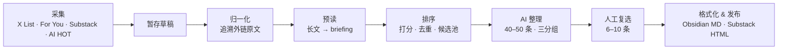

# daily-news

> AI 驱动的每日 AI 资讯日刊：多源采集 → AI 排序整理 → 人工精选 → 一键产出 Obsidian 笔记与 Substack 稿件。

每天从 X/Twitter 列表、X For You 推荐流、Substack 订阅和 AI HOT 中拉取新内容，用 AI 读原文、打分、去重、归纳成几十条结构化候选，再由人工勾选 6–10 条，生成可直接发布的日刊。

📰 **成品示例**：[AI 日刊 2026-10-14](https://blog.yaphet.me/posts/daily-news/DailyNews20261014) · 更多见 [blog.yaphet.me](https://blog.yaphet.me)

## 特性

- **多源增量采集**：X List（`twitter-cli`，失败回退 [twitterapi.io](https://twitterapi.io)）、X For You 推荐流（通过 CDP Chrome 读取登录态）、Substack 公开 RSS、AI HOT RSS；按来源游标增量拉取
- **追溯原始来源**：自动抽取 tweet 外链 / replies，转述型推文改用原文作为主 source；Ben's Bites 等 roundup 会展开为独立条目
- **AI 预读与排序**：快模型先把长文压缩成 briefing；按信息量、证据、新鲜度、可操作性等信号打分，按 canonical URL 去重
- **AI 整理**：主模型归纳为 40–50 条结构化资讯，分为 Product / Tutorial / Opinions/Thoughts 三组
- **人工复选**：终端 checkbox 勾选最终条目，过程可追踪（selection report）
- **可恢复草稿**：采集成功即写入 pending draft，后续任一步失败都可继续
- **偏好学习**：根据历史选择与「评分过高 / 过低」反馈，生成需人工确认的排序调整建议
- **双 AI 路径**：OpenAI 优先，未配置时自动切换到任意 OpenAI 兼容的聚合服务

## 工作流程



`npm run generate:review` 走同一条链路，但在人工复选前停下，只输出审阅包（适合定时任务）。

## 快速开始

**环境要求**：Node.js 20+；采集 X List 需要本机可用的 `twitter-cli`（或配置 `TWITTERAPI_KEY` 作为回退）；采集 For You 推荐流需要开启远程调试（默认 `9222` 端口）并已登录 X 的 Chrome。

```bash
npm install
cp .env.example .env   # 按注释填写
npm run generate
```

### 命令

| 命令 | 作用 |
|------|------|
| `npm run generate` | 完整流程：采集 → 整理 → 人工复选 → 发布 |
| `npm run generate:review` | 非交互：生成审阅包，不复选、不发布、不推进游标 |
| `npm run generate:review:diagnose` | 打印运行环境指纹并检查 `twitter-cli` / 代理，不进入 AI 整理 |
| `npm run preferences:update` | 根据历史选择生成偏好画像和建议 |
| `npm run preferences:review` | 确认偏好建议，写入生效规则 |
| `npm run feedback:apply -- --date=YYYY-MM-DD` | 应用某一期的评分反馈调整 |
| `npm test` | 运行测试 |

## 配置

所有变量见 [`.env.example`](.env.example)。

| 变量 | 默认值 | 说明 |
|------|--------|------|
| `ENABLED_SOURCES` | `twitter,aihot` | 启用的来源，可选 `twitter`、`substack`、`aihot` |
| `OPENAI_API_KEY` | – | 填写则走 OpenAI；留空走下面的聚合商路径 |
| `OPENAI_MODEL` | `gpt-4o` | 主整理模型 |
| `SUBSTACK_READER_MODEL` | `gpt-4o-mini` | 长文预读模型 |
| `AI_BASE_URL` / `AI_API_KEY` / `AI_MODEL` | – | OpenAI 兼容聚合服务 |
| `TWITTER_LIST_ID` | 内置 AI/Tech 列表 | 要采集的 X List |
| `TWITTERAPI_KEY` | – | twitterapi.io Key，`twitter-cli` 失败时回退 |
| `ENABLE_TWITTER_RECOMMENDATIONS` | `true` | 是否采集 For You 推荐流 |
| `TWITTER_RECOMMENDATION_CDP_ENDPOINT` | `http://127.0.0.1:9222` | 推荐流账号所在 Chrome 的 CDP 地址 |
| `TWITTER_RECOMMENDATION_BATCH_SIZE` / `_BATCH_COUNT` | `50` / `6` | 推荐流每批条数 / 批次数 |
| `TWITTER_RECOMMENDATION_BATCH_MIN_DELAY_MS` / `_MAX_DELAY_MS` | `8000` / `20000` | 批间随机等待 |
| `TWITTER_RECOMMENDATION_FILTER_MODEL` | `gpt-4o-mini` | 推荐流相关性预筛模型 |
| `SUBSTACK_PUBLICATION_URL` | – | 你的 Substack 地址，用于读取公开 follow 列表 |
| `SUBSTACK_SOURCE_MAX_POSTS` / `_PER_PUBLICATION` | `40` / `2` | Substack 每次总上限 / 单个 publication 上限 |
| `AIHOT_FEED_URL` / `AIHOT_SOURCE_MAX_ITEMS` | `feed.xml` / `50` | AI HOT RSS 地址与条数 |
| `OBSIDIAN_VAULT_PATH` | – | 日刊保存目录（绝对路径），留空只输出到 `output/` |
| `HTTP_PROXY` / `HTTPS_PROXY` / `NO_PROXY` | – | 代理，同时作用于采集和 AI 请求 |

> 推荐流账号的 Cookie 每次运行时从 Chrome 动态读取，**不要**写进 `.env`。

## 输出

| 路径 | 内容 |
|------|------|
| `output/YYYY-MM-DD-substack.html` | Substack 稿件，浏览器打开后全选复制，粘贴到 Substack 编辑器 |
| `$OBSIDIAN_VAULT_PATH/YYYY-MM/YYYY-MM-DD-daily-news.md` | Obsidian 笔记 |
| `output/YYYY-MM-DD-review.{json,md}` | 审阅包（review 模式） |
| `output/YYYY-MM-DD-selection-report.json` | 打分、候选池、AI 与人工入选记录 |
| `data/state.json` | 增量采集游标，只在发布成功后推进 |
| `data/pending-draft.json` | 未完成流程的暂存草稿 |
| `data/preference-rules.json` | 已确认的排序偏好规则（换机器请一并带上） |

## 项目结构

```
daily-news/
├── src/
│   ├── generate.ts      # 主入口，串联整条 pipeline
│   ├── collect.ts       # 各来源采集、外链归一化、roundup 展开
│   ├── rank.ts          # 打分、去重、候选池
│   ├── curate.ts        # 长文预读 + AI 整理
│   ├── select.ts        # 终端人工复选
│   ├── format.ts        # Obsidian / Substack 格式化
│   ├── publish.ts       # 写出产物
│   ├── review.ts        # 审阅包
│   ├── preferences.ts   # 偏好学习
│   └── ...
├── prompts/curator.md   # AI 整理 prompt
├── tests/               # node:test 测试
├── data/                # 游标、草稿、偏好规则
└── .env.example
```

## 说明

- 只抓取公开内容：Substack 付费 / 仅订阅者可见的文章不会被采集；外链网页抓取是 best-effort，失败就保留原推文。
- 媒体目前只渲染图片，视频和 GIF 仅保留元数据。
- 最终发布哪几条永远由人决定，AI 只负责缩小范围。
